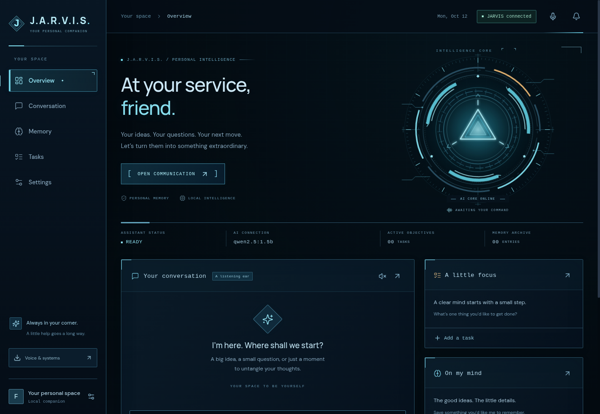

# JARVIS downloads

## Windows v0.1.2

[Download the Windows EXE v0.1.2](https://github.com/asadbeknabiyev0624-afk/As/raw/refs/heads/jarvis-downloads/JARVIS-Windows-v0.1.2.exe)

JARVIS now has the cyan reactor HUD, a visible microphone button, offline British English speech and microphone transcription after a one-time voice download, and automatic attempts to restart a stopped local Ollama server.

1. Close the old JARVIS and open the new EXE.
2. If AI is offline, click **Connect AI**. Download the selected model if needed.
3. For voice, open **Settings → British voice & microphone → Download voice & microphone** (about235MBonce). When ready, test the voice, enable spoken replies, and tap the microphone to record. Tap again, review your words, then send.

Windows10/11 x64. This is an unsigned personal development build. All35 automated tests passed; a packaged cloud desktop test verified real Ollama process recovery. Voice installation, transcription and playback were tested with fixtures; real Windows speech/model execution remains unverified.



## Android

[Download Android APK](https://github.com/asadbeknabiyev0624-afk/As/raw/refs/heads/jarvis-downloads/JARVIS-Android.apk). Android8+, unchanged companion APK0.2.0 signed with its development key. Its AI still runs on your PC, and the Android APK uses the phone's speech services.

JARVIS-SHA256SUMS.txt lists checksums for the exact builds.

# JARVIS EXE + APK

Windows uchun **JARVIS-Windows.exe** faylini oching. Android uchun **JARVIS-Android.apk** faylini o‘rnating. Telefonda AI ishlashi uchun kompyuteringizda JARVIS ochiq va internetga ulangan bo‘lishi kerak.

Ollama o‘rnatilgan bo‘lsa, JARVIS ichidagi **Download AI** tugmasini bosing va **Connected and ready** chiqishini kuting. Windows versiyasi: **0.1.2**; Android APK o‘zgarmagan.

| Device | Download | Requirement |
| --- | --- | --- |
| Computer | `JARVIS-Windows.exe` | Windows 10 or 11, 64-bit x64 |
| Phone | `JARVIS-Android.apk` | Android 8 or newer |

## Start on Windows

1. Save `JARVIS-Windows.exe` in a folder you control, then double-click it. This portable app includes its server and web interface; you do not need Node.js, npm, or a terminal to launch it. It is an unsigned personal development build, so Windows may show an unknown-publisher notice.
2. If Ollama is already installed, go straight to step 3. Otherwise, choose **Install Ollama** in JARVIS's setup card, finish the official Windows installation, then reopen JARVIS.
3. On **Overview** or **Conversation**, choose **Download AI** in the setup card. The same controls are available under **Settings → Desktop & Android**. JARVIS connects to Ollama and downloads the selected model; the default `qwen2.5:1.5b` download is about 1 GB.
4. Keep JARVIS open and wait until it says **Connected and ready**. Progress and download errors remain visible in the setup card. JARVIS verifies that Ollama lists the installed model before reporting readiness. If setup fails, read the displayed error, address that issue, and choose **Retry setup**.
5. Add your name and preferences in Settings, then send a message.

The AI runs on your own computer without a paid AI API or subscription. Initial installation and model downloading need internet access; local AI replies can work afterward without internet. Notes and tasks work even before the model is ready. Larger models are optional and require more computer memory.

## Install and connect Android

1. Transfer `JARVIS-Android.apk` to your phone and open it. If Android asks, allow installation from the browser or file manager you are using, then complete installation.
2. Install [Tailscale](https://tailscale.com/download) on Windows and Android. Sign both devices into the same private network. Check the current personal-plan options when creating your account.
3. Keep the Windows JARVIS app open. In PowerShell on the computer, run:

   ```powershell
   tailscale serve --bg http://127.0.0.1:3001
   ```

   Follow any prompt to enable private HTTPS. Copy the actual `https://` address that Tailscale prints.
4. Open the JARVIS Android app and enter that HTTPS address. Keep Tailscale connected on the phone.
5. On Windows, choose **Settings → Desktop & Android → Copy phone key**, or use the **JARVIS → Connect Android phone** menu. Transfer that key privately and enter it on the phone's unlock screen.

Use **Tailscale Serve** for this private connection. Tailscale Funnel publishes a service publicly and is not needed here. The Android APK connects to the AI on your computer; it does not include an AI model. Your PC must remain awake, online, and running JARVIS for phone conversations and updates, including when you are away from home.

The APK is signed with a development key for this personal build. It is not a Play Store release. Keeping the same signing key allows future APK updates without uninstalling the app.

## Voice, memory, and access

Tap the microphone to dictate, review the text, then send it. Allow microphone permission when Android asks. Turn on the speaker button for spoken replies. Android uses its installed speech recognition and text-to-speech services; available languages, offline support, and voices depend on those services. Windows v0.1.2 uses offline Whisper transcription and the Piper Alan British English voice after voice setup.

On Windows, open **Settings → British voice & microphone → Download voice & microphone** once, approximately 235 MB. Wait for **British voice is ready**, test the voice, and turn **Spoken replies** on. Use the microphone in the header or conversation to record; tap again to stop and review your words before sending. English is the default microphone language, with Uzbek and Russian also available. Windows spoken replies use British English. The app does not use Chromium's network speech-recognition service for Windows dictation.

The downloaded tools and models stay under the app's private voice directory. Whisper and Piper archives are checked against pinned SHA-256 digests. Model downloads use verified HTTPS, an exact Hugging Face revision, and published LFS SHA-256 or Git-blob checksums. Failed or changed downloads are rejected. Model cards and component notices are retained with the voice assets.

If a helper cannot start because of missing DLLs, install Microsoft's [Visual C++ x64 redistributable](https://aka.ms/vs/17/release/vc_redist.x64.exe), then retry voice setup. If microphone access is denied, enable **Allow desktop apps to access your microphone** in Windows privacy settings. The Android APK continues to use its phone's installed speech services.

This version uses push-to-talk. It does not listen continuously or deliver scheduled alarms after the app closes. Task notifications require the app to remain open and connected.

Conversations, memories, and tasks live in the Windows app's user-data directory, with app data under its `data` folder. The phone-access key is generated automatically for each installation and saved in `connection.json`; Windows encrypts it using the signed-in user's DPAPI key. The desktop app unlocks its own trusted local interface automatically. Phone access requires the key. Keep the key private and avoid deleting the app's user-data folder if you want to retain your memories and connection.

The companion server listens at `127.0.0.1:3001` and requires its key for API access. Ollama stays local. Tailscale supplies the private HTTPS connection to the phone; opening a public router port is unnecessary.

## If setup stalls

- **Model needs setup:** With Ollama installed, choose **Download AI** on Overview or Conversation and wait for **Connected and ready**. If an error appears, it remains in the setup card; follow that message and choose **Retry setup**.
- **Port 3001 is already in use:** Close the other JARVIS server or application using that port, then reopen the EXE.
- **Phone cannot connect:** Check that the PC is awake, JARVIS is open, and Tailscale is connected on both devices. Use the HTTPS address printed by `tailscale serve`.
- **Phone cannot unlock:** Copy the key from the currently running Windows app and enter that exact key on the phone.
- **Microphone is unavailable:** Check microphone permission and the installed speech service, or type your message.

## Rebuild from source

Use Node.js 24 for development and native builds. The commands below rebuild the files on Linux; running the downloaded EXE or APK does not require these tools. Run them from the repository directory. Cloud cache paths stay under `/workspace`:

```bash
export XDG_CACHE_HOME=/workspace/.jarvis-desktop-tools/cache
export ELECTRON_CACHE=/workspace/.electron-cache
export ELECTRON_BUILDER_CACHE=/workspace/.electron-builder-cache
export CSC_IDENTITY_AUTO_DISCOVERY=false
npm ci --cache /workspace/.cache/npm
NODE_USE_ENV_PROXY=1 electron_config_cache="$ELECTRON_CACHE" \
  node node_modules/electron/install.js
npm test
npm run package:windows -- -c.electronDownload.cache="$ELECTRON_CACHE"
npm run package:android
```

Electron 44's npm package does not run a postinstall download automatically. The explicit `install.js` command installs the development runtime and verifies its download. `NODE_USE_ENV_PROXY=1` uses the proxy already configured in the cloud environment. The builder cache option selects the same cache for Windows packaging. On another machine, replace the `/workspace` paths with writable cache directories.

The Windows portable output is `release/windows/JARVIS-0.1.2-Windows-x64.exe`; the download copy is named `JARVIS-Windows.exe`. Windows packaging uses `win.signAndEditExecutable: false`, so the Linux build does not need Wine or a signing certificate. Android remains version 0.2.0 and uses the same `JARVIS-Android.apk` download.

The Android build script provisions checksum-verified SDK/JDK tools as needed and produces `../scratch/JARVIS-Android.apk` by default. It requires Bash, curl, unzip, zip, tar, and checksum utilities. `JARVIS_ANDROID_TOOLS` and `JARVIS_ANDROID_OUTPUT` can override its tool directory and output path. The private development signing key and password remain outside the repository in the tool directory; do not include them in ZIPs or publish them. The build script verifies the APK signature and ZIP alignment before completion.

Package-format and signature checks do not establish that either app runs correctly on real devices. Windows launch, Android installation, the private connection, and device voice behavior require testing on Windows and Android hardware.
